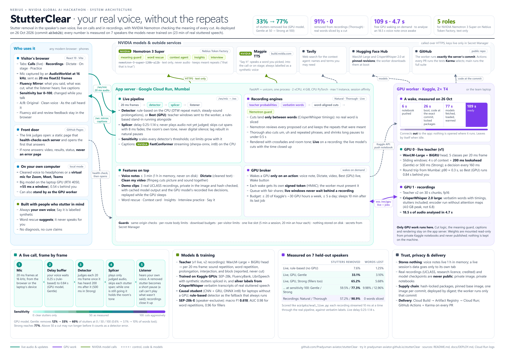
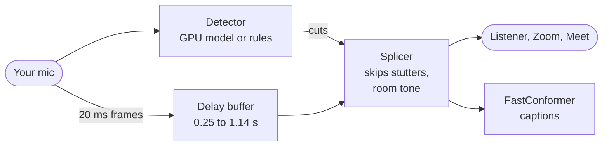
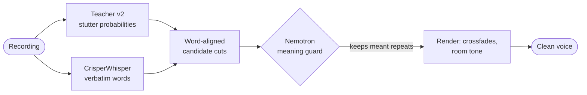

<div align="center">

# StutterClear

### Your real voice, without the repeats.

Stutter removal in **your own voice**: live on calls, and in recordings, voice notes and videos.<br>
NVIDIA Nemotron checks the meaning of every cut. Nothing is re-synthesised: the listener hears *you*.

[](https://pradyuman-aviator.github.io/stutterClear/)
[](https://github.com/Pradyuman-aviator/stutterClear/actions/workflows/tests.yml)
[](LICENSE)

[](#nvidia-and-nebius-inside)
[](#nvidia-and-nebius-inside)
[](#nvidia-and-nebius-inside)
[](#nvidia-and-nebius-inside)

**[Try it](https://pradyuman-aviator.github.io/stutterClear/)** ·
**[Watch the video (2:58)](https://youtu.be/7Gc7NccUGN8)** ·
**[Architecture (PDF)](docs/StutterClear_Architecture.pdf)** ·
**[How it works](#how-it-works)** ·
**[Results](#results)** ·
**[Run it yourself](#run-it-yourself)**

</div>


About 70 million people stutter. On calls, in interviews and in voice messages, the repeats are what
people hear first. Existing tools either retrain speech over months or replace your voice with a
synthetic one. **StutterClear keeps your voice and gives you a choice about what the listener hears.**
It removes repeated sounds and words, broken-off starts and, if you want, fillers such as "um", and it
leaves everything you meant. It is an assistive tool, not a treatment, and it never speaks for you.

Built for the **Nebius × NVIDIA Global AI Hackathon**.

<table>
<tr>
<td align="center" width="33%"><h2>33% → 77%</h2>of stutters removed <b>live</b> by the GPU model: Gentle by default, up to Strong at full sensitivity</td>
<td align="center" width="33%"><h2>91% · 0</h2>of stutters removed from <b>recordings</b> (Thorough), with <b>0</b> real words sliced by a cut</td>
<td align="center" width="33%"><h2>5 roles</h2>for <b>NVIDIA Nemotron 3 Super</b> on Nebius Token Factory, reading text only, never audio</td>
</tr>
<tr>
<td align="center"><h2>3 NVIDIA models</h2>Nemotron 3 Super for language, FastConformer for captions, Magpie for the one labelled synthetic voice; our own models trained on NVIDIA GPUs</td>
<td align="center"><h2>≈ 2 min</h2>for a free cloud GPU to wake on demand; then an 18.5 s voice note is analysed in <b>4.7 s</b></td>
<td align="center"><h2>7 speakers</h2>every number measured on speakers the models never trained on: 23 minutes of real stuttered speech</td>
</tr>
</table>

## Contents

- [What it does](#what-it-does)
- [NVIDIA and Nebius inside](#nvidia-and-nebius-inside)
- [How it works](#how-it-works)
- [Research contributions](#research-contributions)
- [Results](#results)
- [Run it yourself](#run-it-yourself)
- [Hosted demo](#hosted-demo)
- [Reference: configuration, HTTP API, training, troubleshooting](#reference)
- [Limitations](#limitations) · [Roadmap](#roadmap) · [Privacy](#privacy) · [Data, licences and credits](#data-licences-and-credits) · [Repository map](#repository-map)

## What it does

| | What it is | How it works today |
|---|---|---|
| **Live** | Your mic (or your browser's, on the hosted demo), cleaned in real time and sent to headphones or a virtual mic for Zoom, Meet or Teams. | The big model on a GPU removes **33% of stutters in Gentle** and **65% in Strong**, 0.5-0.85 s behind you. The **Sensitivity bar** takes that to 60% and 77%. Without a GPU, a rule-based detector runs instead. |
| **Clean a voice note** | Record or upload a message (up to 3 minutes) and get it back cleaned, to play or download. | Cuts land **between words only**: 57% of stutters removed in Natural, **91% in Thorough** (fillers and repeated phrases too), with **no real word sliced**. |
| **Hear it on a real recording** | Three real stuttered recordings (UCLASS: men aged 18 to 35, about 30 s each, credited on the page), with A/B playback. No mic needed. | Every engine side by side on the same speech, including the GPU model's live decisions, even while the GPU sleeps. |
| **Dictate** | Speak or upload, and get the text without the stutters, ready to paste into an email or a chat. | The Thorough engine read as text; removed words are shown struck through. |
| **Clean my video** | Upload a talk, a post or a recorded answer (up to 3 minutes) and get it back with the stutters cut from picture and sound together. | The recording engines on its soundtrack; ffmpeg cuts at word boundaries with 10 ms fades. |
| **On stage** | Paste your speech; the highlight follows what you say, and when you are stuck the next words appear. | Script following from the live captions. Say it speaks a word in a labelled synthetic voice, only on your click (NVIDIA Magpie TTS). |
| **Practice** | A mock interview for a role and company: spoken questions, answers by voice, three practice points at the end. | Nemotron researches the role and asks one question at a time. It never comments on how you speak. |
| **Journal** (on your own computer) | Stutters a minute by day, this week against the last, your hardest words and first sounds. Opt-in, never audio. | Counts from each live session and voice note. |

### Live: modes and sensitivity

| Mode | What is removed | Delay behind you (big model on a GPU) |
|---|---|---|
| **Off** | Nothing: your voice passes straight through (the mirror still shows it). | ~20 ms |
| **Gentle** | Repeated sounds and words, broken-off starts, stretched sounds. Fillers stay. | ~0.5 s |
| **Strong** | The same, plus fillers ("um", "uh"). Waits longer, so it hears more. | ~0.85 s |

The **Sensitivity bar** (0 to 100, changed while you talk) sets how readily a stutter is cut. At 50
each mode works as measured; towards 0 only the clearest stutters go; towards 100 it cuts
aggressively, removing more stutters and more often clipping a real word with them.

The delay is the price of hearing a stutter before the listener does: the detector needs a little audio
after a repeat to know it was one. A call cannot play what you have not said yet, so in a call a
removed stutter becomes a short pause; played back as a recording (Listen back, the demo clips), that
time is closed up too.

### Recordings: three engines

| Engine | What is removed | How |
|---|---|---|
| **Natural** | Repeated and broken-off words. Fillers stay. | Offline model plus a verbatim transcript: cuts land between words only. |
| **Thorough** | Natural, plus fillers and repeated phrases ("when he was, when he was"); long pauses shrink to under half a second. | The same, with ordinary disfluencies included. |
| **Live** | What the real-time model caught, with the time closed up. | The real-time pipeline, replayed. "As the call heard it" plays the version with its pauses. |

Every cut in Natural and Thorough is reviewed by Nemotron's meaning guard when a key is set.

### On the page

- **Fluency Mirror**: your voice and what the listener hears, scrolling live, with every removed stutter
  marked in red and labelled (repeat, broken-off start, stretched sound, filler).
- **Live captions** of what the listener hears (NVIDIA FastConformer, streaming, on the CPU).
- **Listen back** after a session: the clean voice, what the call heard, and the original; download the clean one.
- **Word rescue** and the **context card**: stuck on a word? Nemotron suggests the few you most likely mean.
- **Say it in the call**: a suggestion, tapped, is spoken into the call through the same output as your
  voice (a labelled synthetic voice, only on your tap).
- **Review the cuts** of a voice note (good cut, undo, "this moment was a stutter"): StutterClear adapts
  each kind's thresholds to you, and offers to stop asking once it agrees with you 95% of the time.
- **Fluency aid**: hear your own voice 50-200 ms late in headphones (many people find it helps).
- **Timestamps** of every cut as CSV or SRT subtitles, and the transcript with removed words struck through.
- **Esc** pauses the cleaning mid-session (your voice exactly as it is) and brings the mode back.

## NVIDIA and Nebius inside

| Component | What it does in StutterClear |
|---|---|
| **NVIDIA Nemotron 3 Super** (`nvidia/nemotron-3-super-120b-a12b`) on **Nebius Token Factory** | Five roles: the meaning guard, word rescue, the context agent (with Tavily web search), insights, and interview practice. Text only, never audio. |
| **NVIDIA FastConformer** (NeMo streaming, int8 through sherpa-onnx) | Live captions of what the listener hears, on the CPU, at about 0.12x real time. |
| **NVIDIA Magpie TTS** (build.nvidia.com) | "Say it": speaks a word you chose, always labelled as a synthetic voice. |
| **NVIDIA GPUs** | Our own models, trained on Kaggle T4s; the live and recording models run on a pair of T4s that wakes on demand. |

What Nemotron does, and why it needs a language model:

- **Meaning guard.** Before a recording is cleaned, Nemotron reads every proposed cut in its sentence
  and keeps the repeats the person meant: grammar ("I know that that is true", "she had had enough"),
  emphasis ("very very good", "no no no"). Neither the transcript nor the acoustic model can tell a
  stutter from a repeat that was meant. "Try the meaning guard" on the page shows it on any typed
  sentence, with Nemotron's reason for each repeat it keeps.
- **Word rescue.** Stuck on a word (a block)? Nemotron suggests the few words you most likely mean, from
  what you have said so far and your context card. You choose; nothing is said for you.
- **Context agent.** Say where you will speak ("interview at NVIDIA on Friday"); Nemotron, with Tavily
  search, fills the context card with the names and terms you will need, which word rescue then draws on.
- **Insights.** Three short, supportive notes after a session or voice note. No diagnosis, no cure claims.
- **Interview practice.** A mock interview that researches the role and asks one question at a time.

Nemotron 3 reasons before answering: the meaning guard keeps reasoning on (deciding whether a repeat was
meant is a judgement call), the quick features turn it off so replies are fast. At startup the app checks
the model is served and, if its name changed, switches to the closest Nemotron available. Replies are
parsed defensively; if Nemotron does not answer, the cuts stand as detected and the page says so.

## How it works

[](docs/StutterClear_Architecture.pdf)

*The whole system on one page: [docs/StutterClear_Architecture.pdf](docs/StutterClear_Architecture.pdf) (click the image).*

**A live call:**



**A recording:**



### 1. Detection models

| Model | What it is | Where it runs |
|---|---|---|
| **Teacher** | WavLM-Large (316M parameters, self-supervised speech model) → learned mix of all 25 layers → 2-layer BiGRU → 5 classes per 20 ms frame: sound repetition, word repetition, prolongation, block, filler. | GPU: live on sliding windows (v1); recordings use v2, which measured better there. |
| **Student** | Small causal model: 80-band log-mel → causal conv → GRU, one output head per lookahead (0 to 800 ms). v1 0.3M parameters; v2 5.2M, distilled from teacher v2. | CPU, for machines without a GPU. |
| **Rule-based** | Compares the start of each speech unit with the previous one (repeats) and finds long, spectrally steady stretches (prolongations). | CPU, always available. |

The app recommends whichever detector this machine can run that measured best on held-out speakers,
counting a wrongly cut word three times as heavily as a missed stutter.

### 2. Training data

- **Synthetic stutters** spliced into fluent, forced-aligned LibriSpeech speech, with exact frame labels:
  rapid sound and word repetitions, phrase repetitions, stretched sounds, blocks, fillers and clusters of
  them. Copies are perturbed in speed, gain and length, and plain pauses are added so silence alone is
  never evidence of a block.
- **SEP-28k / FluencyBank**: 3 s clips with clip-level labels, split by speaker with the official
  SEP-28k-E partition, so test speakers never appear in training.
- **Silver frame labels for real stuttered speech.** CrisperWhisper, a verbatim speech recogniser,
  transcribes 11,933 SEP-28k clips and 455 UCLASS recordings with word timings, stutters included. A
  filler (`[UM]`) is a filler, a word ending in `-` is a broken-off start, and every copy of a repeated
  word or 2-3 word phrase except the last is a repetition. Frames within 100 ms of a word edge are not
  trained on, because verbatim timings are about that far off; prolongations and blocks do not show in
  a transcript, so those classes are masked there and learned from the other data.

Teacher v2 trained for 10,000 steps (5.7 h on two T4 GPUs on Kaggle), checkpoints chosen on real speech
from validation speakers only.

### 3. The live pipeline

1. **Delay buffer.** Your voice is played back a fraction of a second late.
2. **Detector.** The teacher runs on sliding windows: 4 s of past audio plus a short lookahead (200 ms in
   Gentle, 500 ms in Strong), a decision every 160 ms. One window takes about 53 ms on a laptop RTX 4050,
   so it keeps up with room to spare. A cut opens when a stutter class crosses its threshold and closes
   after it stays low (hysteresis); short gaps between stutters are merged.
3. **Splicer.** Skips what was marked before it reaches the output, with an 8 ms crossfade:
   - it never plays audio the detector has not judged yet;
   - where speech meets speech across a cut, it inserts 60 ms of your room's own background, instead of
     gluing two sounds together (a glued join is heard as a jerk);
   - gaps are filled with your room tone, never digital silence (a background that switches off and on
     is heard as pumping);
   - time saved by a cut is rebuilt in the next natural pause, and lag above the target is shed by
     shortening pauses, so you never drift further behind;
   - a cut still open too long is dropped and the audio played: a stuck detector must never silence you.

### 4. Recordings

1. The teacher reads the whole recording (no lookahead limit).
2. CrisperWhisper writes down every word with timings, stutters included.
3. Candidate cuts are the repeated and broken-off words (plus fillers and repeated phrases in Thorough).
   A candidate is cut only if the teacher also hears a stutter within 100 ms of it, so a repeat the
   transcript shows but the voice does not is kept. A repeated phrase is cut or kept as a whole.
4. **Meaning guard**: Nemotron reviews every candidate in its sentence and returns the ones the person
   meant, with a reason; those are kept.
5. Each cut runs from the start of a word to the start of the next one, so no real word is ever sliced.
   Joins use an aligned 8 ms crossfade and, where speech meets speech, 90 ms of the speaker's own room
   tone, level-matched.

Why word boundaries: the model's frame edges are about 100 ms off, a whole syllable. Cutting on them
sliced a real word in 30-43% of cuts, which is exactly what sounds like a jerk; word-aligned cutting
slices none.

### 5. Hosting: a free GPU that comes when it is needed

The app runs on **Google Cloud Run** (CPU, Mumbai). The GPU features (voice notes, Dictate, Clean my
video, the big model live) go to a **GPU worker on a free Kaggle notebook (2× T4)** that the app wakes
only when a visitor asks for one. The worker connects *out* to the app over a signed WebSocket, does only
the GPU work (the teacher's probabilities and CrisperWhisper's words), and sleeps again 10 minutes after
its last job. A wake takes about 2 minutes, shown step by step on the page, while everything else keeps
working. A static **front door** on GitHub Pages is the public link: it opens the app, or shows the demo
video, the results and the servers' status instead of an error.

## Research contributions

A novelty check against patents and the 2026 literature
([`reports/StutterClear novelty and SOTA check.md`](reports/StutterClear%20novelty%20and%20SOTA%20check.md))
puts StutterClear's contributions in measurement and working systems, not in the ideas alone:

- **First implemented and measured system that removes stutters from the speaker's real voice in real
  time.** The idea was patented ([IBM, 2012](https://patents.google.com/patent/US8682678B2/en)) but never
  built or evaluated. StutterClear measures it end to end on held-out speakers, through the real
  delay buffer, detector and splicer.
- **Cuts on verbatim word boundaries.** Model-edge cuts sliced a real word in 30-43% of cases; aligning
  to CrisperWhisper's word timings brings that to zero, while removing 91% of stutters from recordings.
- **Silver training labels from verbatim ASR** on real stuttered speech, with per-class loss masks; the
  novelty check found no published precedent.
- **An LLM meaning guard for speech editing**: NVIDIA Nemotron reviews every proposed cut and keeps the
  repeats that were meant.
- **Lookahead-indexed detection**: a causal student with one head per lookahead (0 to 800 ms), built to
  measure how much future audio stutter detection needs, which no published work has measured.

## Results

Measured on **7 UCLASS speakers (23 minutes of speech) that no model saw in training**, scored against
verbatim labels from CrisperWhisper. "Removed" is the share of stutter words removed. Every table names
the script that produces it; the outputs are in `runs/eval/`.

**Live, end to end** (`scripts/eval_live.py`: each recording streamed 10 ms at a time through the real
pipeline):

| detector | Gentle (fillers kept) | Strong (fillers too) |
|---|---|---|
| rule-based, no GPU | 7.6% | 10.2% |
| **teacher v1 on a GPU (what the app uses)** | **33.1%** | **65.2%** |

**The Sensitivity bar**, measured the same way through the app's own code path:

| sensitivity | teacher v1, Gentle | teacher v1, Strong | rule-based, Gentle |
|---|---|---|---|
| 0 (clear stutters only) | 12.2% | 51.3% | 0.8% |
| 50 (as measured above) | 33.1% | 65.2% | 7.6% |
| 75 | 48.4% | 75.9% | 20.4% |
| **100 (cuts aggressively)** | **59.5%** | **77.3%** | 41.4% |

Higher sensitivity removes more stutters and also clips real words more often; the evaluation scripts
report both for every setting. Above 50 a cut may run longer before the safety limits take it for a
detector error, so the top of the bar keeps cutting more rather than less.

**How much lookahead the big model needs** (`scripts/teacher_lookahead.py`, teacher v1, fillers included):

| lookahead | 200 ms | 500 ms | 1 s | whole recording |
|---|---|---|---|---|
| stutters removed | 53.8% | 60.9% | 68.3% | 61.8% |

The live machinery itself costs almost nothing: cutting the same 200 ms probabilities offline removes
34.8% in Gentle, the full live pipeline 33.1%. What holds live back is how little the model hears ahead.

**Recordings** (`scripts/eval_recordings.py`):

| recipe | real words sliced | stutters removed |
|---|---|---|
| model edges (the first version) | 98 | 49.9% |
| **word-aligned, Natural, teacher v2 (what the app uses)** | **0** | **57.2%** |
| **Thorough: fillers and repeated phrases too** | **0** | **90.9%** |

A repeated phrase ("when he was, when he was younger") is cut or kept as a whole. Teacher v2 is the
acoustic check because it both confirms more stutters and leaves more normal speech untouched than v1.

**Standard benchmark** (`scripts/eval_teacher.py`): teacher v2 on the official speaker-exclusive
SEP-28k-E test set (6,559 clips), thresholds tuned on validation speakers only:

| | sound repetition | word repetition | prolongation | block | filler |
|---|---|---|---|---|---|
| F1 | 0.50 | 0.81 | 0.55 | 0.41 | 0.83 |
| AUC | 0.91 | 0.98 | 0.90 | 0.79 | 0.96 |

Macro F1 **0.618**. Blocks are the hardest class: a block is mostly silence, and human labels for it
disagree most.

**Listening check** (`scripts/check_audio.py --demo`): the intended reading of every cleaned demo clip
matches the original's to a word error rate of 0.07-0.15 (part of which is transcription noise at clip
edges); no dropouts or clicks are added.

## Run it yourself

Windows 10/11 (the live mic and speaker path uses WASAPI), Python 3.11+, a microphone. An NVIDIA GPU
with CUDA (about 5 GB free) enables the big model live and voice notes; everything else runs on the CPU.

```
git clone https://github.com/Pradyuman-aviator/stutterClear.git
cd stutterClear
pip install -r requirements.txt     # install the CUDA build of PyTorch first, from pytorch.org
python scripts/run_app.py           # opens http://127.0.0.1:8765 (or the next free port)
python -m pytest -q                 # the test suite
```

- **Models.** Checkpoints are not in the repository (they are large, and their training data is licensed
  for research only). The Kaggle jobs in `kaggle/` train them; put the live teacher (v1) at
  `runs/kaggle_teacher/teacher/best.pt` and the recordings teacher (v2) at
  `runs/kaggle_teacher_v2/teacher_v2/best.pt` (without v2, recordings use v1). Without a checkpoint the
  app still runs, with the rule-based detector and no voice notes.
- **Live captions** (optional, 106 MB): `python scripts/download_asr.py`.
- **Nemotron** (optional): get a key from Nebius Token Factory, set it where the app runs, open a new
  terminal and check every feature in one go:
  ```
  setx NEBIUS_API_KEY "your-key"          # Windows; on Linux/macOS: export NEBIUS_API_KEY=...
  python scripts/check_nemotron.py        # chat, word rescue, meaning guard, insights, context agent
  ```
- **In calls.** Use headphones (laptop speakers feed back into the mic). Install a virtual audio cable
  (e.g. VB-CABLE), pick "CABLE Input" as the output in Setup, and "CABLE Output" as the microphone in
  Zoom, Meet or Teams.
- **The UI** is a Vite + React app in `stutterclear/app/web`; its build is committed in
  `stutterclear/app/static`, so Node is only needed to change it (`npm install && npm run build`).

## Hosted demo

**https://pradyuman-aviator.github.io/stutterClear/** (`?stay=1` shows its status page). Setup and the
other ways to host it (Cloud Run with a Kaggle GPU, a Nebius AI Cloud GPU VM with Docker Compose and
Caddy, the laptop through an HTTPS tunnel) are in [`docs/DEPLOY.md`](docs/DEPLOY.md).

<details>
<summary><b>What a public server does differently</b> (<code>STUTTERCLEAR_HOSTED=1</code>)</summary>

- Visitors use their browser's microphone (captured at 16 kHz, or at the device's rate and resampled in
  the page, as Firefox requires).
- A live session's captions, waveforms and audio go only to the browser tab that started it.
- One live session at a time, up to 5 minutes, ended after 15 s without audio; others are told it is
  someone else's turn.
- At most 4 voice notes wait for the GPU at once, and 20 are kept in memory, each for at most an hour.
- Each visitor gets a fair share of the GPU worker: one recording at a time, 10 minutes of audio an hour
  and a few GPU starts a day; pages and requests from other websites are refused.
- The GPU works within a budget: at most 20 of Kaggle's ~30 weekly GPU hours and 5 a day.
- Visitors' Nemotron calls are capped at 60 a minute and Say it at 30, because they spend the owner's
  credits.
- Review feedback stays in the visitor's browser (the page sends its multipliers with a session).
- UCLASS clips are left out unless `STUTTERCLEAR_UCLASS_DEMOS=1` (the Cloud Run demo sets it: three
  ~30 s excerpts, credited; the recordings themselves are never in git).
- Nothing is written to disk.

</details>

## Reference

<details>
<summary><b>Configuration</b>: environment variables</summary>

| Variable | Default | Purpose |
|---|---|---|
| `NEBIUS_API_KEY` | (none) | Enables the Nemotron features. Never put it in code or chat. |
| `NEBIUS_BASE_URL` | `https://api.tokenfactory.nebius.com/v1/` | Token Factory endpoint (as in the Nebius quickstart). |
| `NEBIUS_MODEL` | `nvidia/nemotron-3-super-120b-a12b` | Nemotron model id (falls back to the closest served one). |
| `TAVILY_API_KEY` | (none) | Web search for the context agent. |
| `NVIDIA_API_KEY` | (none) | Enables Say it (NVIDIA Magpie TTS on build.nvidia.com, free). Never put it in code or chat. |
| `MAGPIE_VOICE` | `Magpie-Multilingual.EN-US.Aria` | Say it's voice (`MAGPIE_SERVER`, `MAGPIE_FUNCTION_ID` override the hosted endpoint). |
| `STUTTERCLEAR_HOSTED` | (off) | `1` = public server: browser mic only, per-tab privacy, the limits above. |
| `STUTTERCLEAR_TEACHER` | `runs/kaggle_teacher/teacher/best.pt` | Live teacher checkpoint (its `live_cuts.json`, if any, sets its cut thresholds). |
| `STUTTERCLEAR_RECORDINGS_TEACHER` | v2 if present, else the live teacher | Teacher for voice notes and demo clips. |
| `STUTTERCLEAR_RECORDINGS_DEVICE` | GPU if it has 10 GB+, else CPU | Where a second (recordings) teacher runs. |
| `STUTTERCLEAR_NOTES` | (on) | `0` = no voice notes (a server without a GPU). |
| `STUTTERCLEAR_UCLASS_DEMOS` | on locally, off when hosted | `1` / `0`: show / hide the UCLASS demo clips (research licence; the Cloud Run demo shows them, credited). |
| `STUTTERCLEAR_FEEDBACK` | `runs/feedback/feedback.jsonl` | Where this computer keeps your review decisions. |
| `STUTTERCLEAR_JOURNAL` | `runs/journal/journal.jsonl` | Where this computer keeps the fluency journal (once started). |

`scripts/run_app.py` takes `--port`, `--host` (`0.0.0.0` in a container), `--no-browser` and
`--strict-port` (exit if the port is taken, for a tunnel pointing at it). The GPU worker and Cloud Run
settings are in [`docs/DEPLOY.md`](docs/DEPLOY.md).

</details>

<details>
<summary><b>HTTP API</b>: everything the page does is available to other clients</summary>

| Endpoint | What it does |
|---|---|
| `GET /api/info` | Features available here (GPU model, captions, Nemotron, voice notes, Say it, interview, where feedback is kept, UCLASS clips), detectors with measured quality, the recommended one. |
| `GET /api/devices` | Microphones and outputs (local only). |
| `POST /api/start`, `POST /api/stop` | Start / stop a live session on this computer's devices (local only). |
| `POST /api/sensitivity` | The Sensitivity bar moved: the session running on this computer cuts more or less readily from then on (local only). |
| `WS /ws/mic` | Live from a browser mic: settings as JSON (mode, detector, sensitivity 0-100), then 16 kHz float32 audio frames (and `{"sensitivity": n}` whenever the bar moves), then `"stop"`; replies with the summary. |
| `WS /ws` | Live updates for the page: waveforms, cuts, captions, stats, about 30 a second. |
| `GET /api/playback`, `GET /api/playback/{clean,heard,original}.wav` | The last session's audio, kept in memory: the clean voice, what the call heard, and the original. |
| `POST /api/notes`, `GET /api/notes/{id}` | Clean a voice note (16 kHz WAV body); poll its status. |
| `GET /api/demo`, `GET /api/demo/{id}?engine=natural\|thorough\|live`, `.../{clean,original,heard}.wav` | Demo samples and cleaned voice notes: timeline, cuts, captions, audio (`heard`: the live engine's call version). |
| `GET /api/demo/{id}/cuts.csv`, `.../cuts.srt` (`?engine=`) | Timestamps of everything removed, on the original recording's clock. |
| `POST /api/guard` | The meaning guard on typed text. |
| `POST /api/rescue`, `POST /api/context`, `POST /api/insights` | Word rescue, context agent, insights. |
| `POST /api/tts` `{text, voice?}` | Say it: NVIDIA Magpie TTS speaks the clicked word; a WAV, with the synthetic-voice label in `X-Voice-Label`. |
| `POST /api/interview/start` `{role, company, posting?}`, `/next` `{role, company, card, history}`, `/summary` | Practice interview: context card and first question, the next question, three practice points. |
| `POST /api/feedback` `{source, id, cut + verdict \| missed_at_s}`, `GET`, `DELETE /api/feedback` | Review decisions (keep or undo a cut, a missed stutter): logged on this computer, which adapts each kind's thresholds; summary; forget. |
| `POST /api/feedback/summary` `{entries}` | The same summary for a log a page keeps itself (public servers store none). |
| `POST /api/say` `{text, page?}` | Say it in the call: the spoken word is mixed into the live session's output (device sessions). |
| `POST /api/video?engine=` (body: a video), `GET /api/video/{id}`, `.../clean.mp4[?download=1]` | Clean my video: progress, cuts and transcript, then the cleaned video. |
| `GET /api/journal`, `POST /api/journal/start`, `DELETE /api/journal` | The fluency journal on this computer (opt-in). |
| `GET /api/gpu`, `POST /api/gpu/wake`, `WS /ws/gpu` | The GPU worker's state, a wake from a visitor's action, and the worker's own signed connection. |

Natural and Thorough timelines also carry `text`: every word as said, whether a cut removed it, and the
clean text (what Dictate copies).

</details>

<details>
<summary><b>Training and evaluation</b></summary>

Training runs on Kaggle GPUs; each job clones this repository, downloads the data and trains:

| Job | What it does |
|---|---|
| `kaggle/silver` | CrisperWhisper verbatim word timings for SEP-28k and UCLASS (`scripts/crisper_label.py`). |
| `kaggle/teacher_v2` | Teacher v2 (`scripts/train_teacher.py`), on one or two GPUs (DDP). |
| `kaggle/student_v2` | Teacher v2 thresholds and the SEP-28k-E test report (`scripts/eval_teacher.py`), then the student (`scripts/train_student.py`). |

Evaluation, all on the 7 held-out UCLASS speakers in `data/external/uclass_eval`:

```
python scripts/eval_live.py --out runs/eval/live_quality.json     # the live pipeline, end to end
python scripts/eval_recordings.py --out runs/eval/recordings.json # Natural / Thorough engines
python scripts/teacher_lookahead.py                               # lookahead vs quality
python scripts/join_quality.py                                    # how jerky the joins are
python scripts/check_audio.py --demo                              # listening check on the demo clips
python scripts/record_live_demo.py                                # the GPU model's live decisions on the demo clips
```

`eval_live.py` and `eval_recordings.py` need the `<wav>.crisper.json` transcripts that
`scripts/eval_splice.py prepare` writes. `scripts/run_file.py` runs any WAV through the live pipeline,
and `scripts/teacher_label.py` / `plot_teacher.py` show what the teacher hears. Every pull request runs
the tests that [Karma](https://github.com/Pradyuman-aviator/Karma) selects from the change; main runs the
full suite.

</details>

<details>
<summary><b>Troubleshooting</b></summary>

| Symptom | Likely cause and fix |
|---|---|
| Jerky or crackly audio on a Bluetooth headset | Bluetooth switches to its low-quality call mode when the mic is open. Judge the sound on wired headphones or speakers. |
| "Waiting for your voice" while you are speaking | Some laptop mic arrays send silence until Windows' voice processing wakes up. Pick another mic, or turn off audio enhancements in Windows sound settings. |
| You hear yourself echo | Laptop speakers feed back into the mic: use headphones. |
| "Best (GPU)" is not offered | No CUDA GPU, or no teacher checkpoint (see Models above). On the hosted demo, press Wake the GPU. |
| No captions | Run `python scripts/download_asr.py`. |
| Nemotron features say they need a key | Set `NEBIUS_API_KEY` and open a new terminal; `python scripts/check_nemotron.py` tells you what works. |
| The first voice note takes a minute or two | CrisperWhisper loads (and downloads, the first time); later notes are faster. On the hosted demo the GPU may be waking. |
| The browser says the microphone is blocked | Allow it for the site (the icon left of the address); the mic only works on https:// or localhost. |
| Port 8765 is taken | `run_app.py` picks the next free port, or pass `--port`. |

</details>

## Limitations

- **Blocks are detected and reported, not removed.** The time a block takes cannot be given back without
  speaking for the person. Stretched sounds are only shortened.
- **Live removes less than recordings.** With half a second of delay the model hears little after a
  stutter; recordings are read whole.
- **In a call, time cannot be given back**: a removed stutter becomes a short pause, because a call
  cannot play what has not been said yet.
- **The numbers are on 7 speakers, 23 minutes**, scored against labels from a speech recogniser, not
  human annotators. The meaning guard has not been measured against human judgements yet.
- **English only**, trained and evaluated on English speech.
- **The best live model needs an NVIDIA GPU**; the CPU fallbacks remove much less.
- **Not tested with users yet.** No clinical claims; StutterClear is not a therapy.
- **Licences are non-commercial** (see below).

## Roadmap

- User testing with people who stutter and with speech therapists, including a listening study.
- A paper on lookahead-indexed causal stutter detection, with evaluations on the official benchmarks.
- Student v2 as a CPU live detector for laptops without a GPU.
- A one-click setup for Zoom, Meet and Teams instead of a virtual audio cable.
- More languages; measuring the meaning guard against human judgements.

## Privacy

- Audio is processed on your computer. Nothing is recorded unless you switch saving on.
- The last session and voice notes are kept in memory for playback (voice notes for at most an hour)
  and are never written to disk. The hosted demo never stores recordings, and a live session's
  captions, waveforms and audio go only to the browser tab that started it.
- Nemotron features send text only (recent captions, the context card, counts), never audio, and only
  when you use them.
- The context card stays in your browser.

## Data, licences and credits

The code is MIT licensed (see [`LICENSE`](LICENSE)). Data and models keep their own terms:

- **UCLASS**, University College London Archive of Stuttered Speech (Howell, Davis & Bartrip, 2009).
  Data collection was supported by the Wellcome Trust. Free for research and teaching; the demo plays
  short excerpts from three adult speakers, credited on the page, and the recordings are never
  redistributed in this repository.
- **SEP-28k / FluencyBank**: CC BY-NC 4.0 (non-commercial).
- **CrisperWhisper**: non-commercial licence; used to create silver labels and to place cuts.
- **LibriSpeech**: CC BY 4.0. **WavLM**: MIT.
- **NVIDIA FastConformer** (NeMo, via sherpa-onnx): see the model card for its licence.
- UI components from ElevenLabs UI and shadcn/ui (MIT).

Commercial use would need a commercial UCLASS licence and models trained only on commercially licensed
or own consented recordings.

## Repository map

- `stutterclear/`: the engine
  - `splicer.py`, `pipeline.py`, `live.py`: delay buffer, splicer, live sessions, sensitivity
  - `detector.py`, `student_runtime.py`, `teacher_runtime.py`, `remote_detector.py`: the detectors
  - `teacher.py`, `student.py`, `synth.py`, `train_data.py`, `silver.py`: models, data, labels
  - `segments.py`: offline cut and join logic
  - `captions.py`: FastConformer captions
  - `nemotron.py`, `guard.py`, `rescue.py`, `context_agent.py`, `insights.py`, `interview.py`: Nemotron features
  - `gpu_protocol.py`, `gpu_worker/`: the GPU worker and its wire protocol
- `stutterclear/app/`: FastAPI server (`server.py`), GPU broker (`gpu.py`), demo samples (`demo.py`),
  voice notes (`notes.py`), video (`video.py`), React UI (`web/`, built into `static/`)
- `frontdoor/`: the GitHub Pages front door
- `deploy/`: Cloud Run (`cloudrun/`) and other hosting
- `scripts/`: run, train, evaluate, deploy, download data
- `kaggle/`: GPU training jobs
- `tests/`: the test suite
- `runs/eval/`: measured results (numbers only)
- `docs/`: the architecture page (`StutterClear_Architecture.pdf`), deployment (`DEPLOY.md`), design
  (`DESIGN.md`), hackathon submission kit (`SUBMISSION.md`), implementation and learning guides
- `reports/`, `research_notes/`: literature review and novelty check
