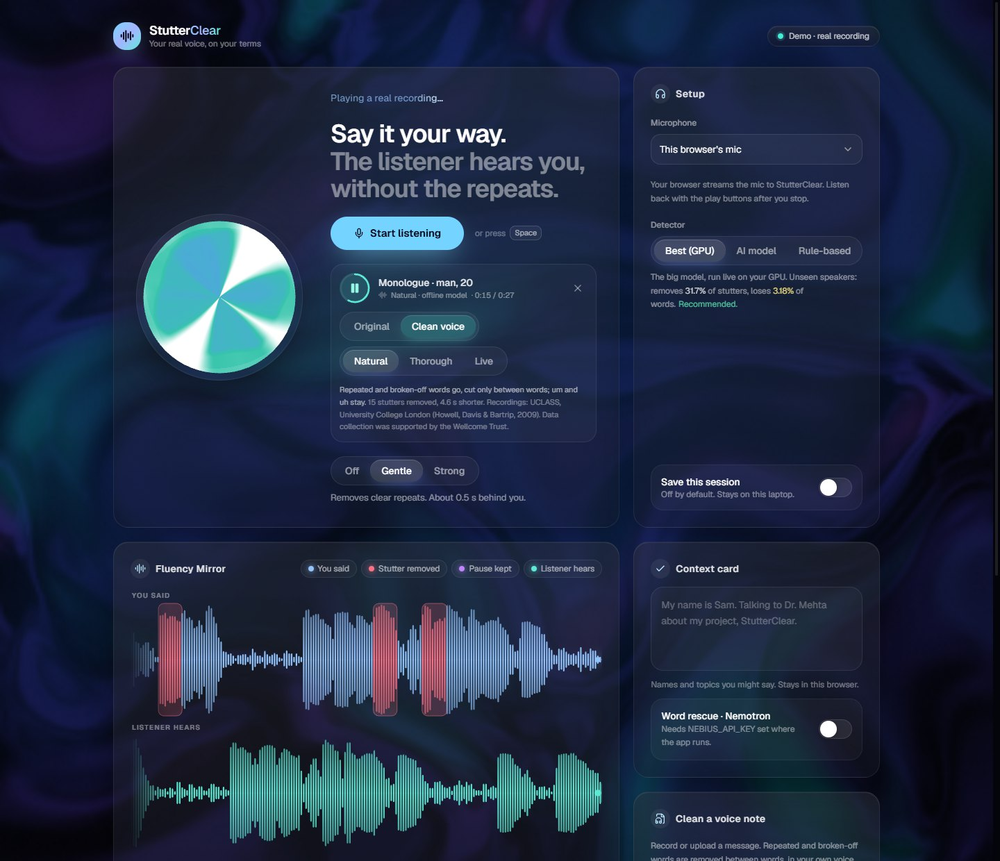

# StutterClear

**Your real voice, on your terms.** StutterClear removes stutters (repeated words, broken-off
starts, and optionally fillers such as "um") from your speech, in **your own voice**: live in calls,
or from recordings and voice notes. Nothing is re-synthesised: the listener hears you, minus the
repeats.

It is an assistive tool, not a treatment, and it never speaks for you. Stuttering is part of how many
people talk; StutterClear gives you a choice about what a listener hears.



Built for the Nebius × NVIDIA Global AI Hackathon: NVIDIA Nemotron on Nebius Token Factory checks
the meaning of every cut, rescues blocked words and prepares your vocabulary; NVIDIA FastConformer
writes live captions; the hosted demo is built to run on a Nebius AI Cloud GPU VM.

## Contents

- [What it does](#what-it-does)
- [Quick start](#quick-start)
- [How it works](#how-it-works)
- [Measured results](#measured-results)
- [Configuration](#configuration)
- [HTTP API](#http-api)
- [Hosted demo](#hosted-demo)
- [Training and evaluation](#training-and-evaluation)
- [Troubleshooting](#troubleshooting)
- [Limitations](#limitations)
- [Roadmap](#roadmap)
- [Privacy](#privacy)
- [Data and licences](#data-and-licences)
- [Repository map](#repository-map)

## What it does

### Ways to use it (one tab each)

| | What it is | How well it works today (7 speakers it never trained on) |
|---|---|---|
| **Live** | Your mic (or your browser's, on the hosted demo), cleaned in real time, sent to headphones or a virtual mic for Zoom, Meet or Teams. | Big model on a laptop GPU: **33% of stutters removed in Gentle** (fillers kept, 3.1% of words lost) and **65% in Strong** (fillers too, 5.7% lost), 0.5-0.85 s behind you. Without a GPU the rule-based detector removes ~8%. |
| **Clean a voice note** | Record or upload a message (up to 3 minutes) in the browser and get it back cleaned, to play or download. | Cuts land **between words only**: 57% of stutters removed in Natural, **91% in Thorough** (fillers and repeated phrases too), with **no real word cut**. |
| **Try a real recording** | Real stuttered recordings (UCLASS, adult speakers; on this computer only) and read speech from LibriSpeech with synthetic stutters (safe to publish), with A/B playback, no mic needed. | Every engine, side by side, on the same 30 s of speech. |
| **Dictate** | Speak (or upload) and get the text without the stutters, ready to paste into an email or a chat. | The Thorough engine read as text; the removed words are shown struck through. |
| **Clean my video** | Upload a talk, a post or a recorded answer (up to 3 minutes) and get the video back with the stutters cut from picture and sound together. | The recording engines on its soundtrack; ffmpeg cuts at word boundaries with 10 ms fades. |
| **On stage** (needs `NVIDIA_API_KEY`) | Paste your speech; the highlight follows what you say, and when you are stuck the next words appear; Say it speaks them in a synthetic voice, only on your click. | Script following from the live captions; NVIDIA Magpie TTS. |
| **Practice** (needs `NEBIUS_API_KEY`) | A mock interview for a role and company: spoken questions, answers by voice, three practice points at the end. | Nemotron researches the role and asks one question at a time; it never comments on how you speak. |
| **Journal** (on your own computer) | Stutters a minute by day, this week against the last, your hardest words and first sounds. Opt-in, never audio. | Counts from each live session and voice note. |

### Live modes

| Mode | What is removed | Delay behind you (big model on GPU) |
|---|---|---|
| **Off** | Nothing: your voice passes straight through. | ~20 ms |
| **Gentle** | Repeated sounds and words, broken-off starts, stretched sounds. Fillers stay. | ~0.5 s |
| **Strong** | The same, plus fillers ("um", "uh"). Waits longer, so it hears more. | ~0.85 s |

The delay is the price of hearing a stutter before the listener does: the detector needs a little
audio after a repeat to know it was one. Without a GPU, the rule-based detector runs at 0.25 s
(Gentle) and 0.6 s (Strong) but removes much less.

### Recording engines

| Engine | What is removed | How |
|---|---|---|
| **Natural** | Repeated and broken-off words. Fillers stay. | Offline model + verbatim transcript: cuts land between words only. |
| **Thorough** | Natural, plus fillers and repeated phrases ("when he was, when he was"). | Same, with ordinary disfluencies included. |
| **Live** | Exactly what a call would hear. | The real-time pipeline, replayed. |

Every cut in Natural and Thorough is reviewed by Nemotron's meaning guard (below) when a key is set.

### On the page

- **Fluency Mirror**: your voice and what the listener hears, scrolling live, with every removed
  stutter marked in red and labelled (repeat, broken-off start, stretched sound, filler).
- **Live captions** of what the listener hears (NVIDIA FastConformer, streaming, on the CPU).
- **Listen back** after a session: the original and the clean voice, and a download of the clean one.
- **Session summary**: stutters removed, seconds saved, typical delay.
- **Esc** pauses the cleaning mid-session (your voice exactly as it is) and brings the mode back.
- **Say it in the call**: a word-rescue suggestion, tapped, is spoken into the call through the same
  output as your cleaned voice (synthetic voice, labelled, only on your tap).
- **Review the cuts** of a voice note (good cut, undo, "this moment was a stutter"): StutterClear
  adjusts each kind's thresholds to you, and offers to stop asking once it agrees with you 95% of
  the time.
- **Fluency aid**: hear your own voice 50-200 ms late in headphones (many people find it helps).
- **Timestamps** of every cut as CSV or SRT subtitles, and the transcript with removed words struck
  through.

### NVIDIA Nemotron on Nebius Token Factory

Nemotron does the parts that need an understanding of language. It gets text only, never audio,
and each feature is opt-in or shown on demand:

- **Meaning guard.** Before a recording is cleaned, Nemotron reads every proposed cut in its
  sentence and keeps the repeats the person meant: grammar ("I know that that is true", "she had
  had enough"), emphasis ("very very good", "no no no"). Neither the transcript nor the acoustic
  model can tell a stutter from a repeat that was meant. "Try the meaning guard" on the page shows
  it on any typed sentence, with Nemotron's reason for each repeat it keeps.
- **Word rescue.** Stuck on a word (a block)? Nemotron suggests the few words you most likely mean,
  from what you have said so far and your context card. You choose; nothing is said for you.
- **Context agent.** Say where you will speak ("interview at NVIDIA on Friday"); Nemotron, with
  Tavily web search if a key is set, fills the context card with the names and terms you will need,
  which word rescue then draws on.
- **Insights.** Three short, supportive notes after a session or voice note: which kinds of
  stutters, on which words, one practical idea. No diagnosis, no cure claims.

## Quick start

Windows 10/11 (the live mic and speaker path uses WASAPI), Python 3.11+, a microphone. An NVIDIA
GPU with CUDA (about 5 GB free) enables the big model live and voice notes; everything else runs on
the CPU.

```
git clone https://github.com/Pradyuman-aviator/stutterClear.git
cd stutterClear
pip install -r requirements.txt     # install the CUDA build of PyTorch first, from pytorch.org
python scripts/run_app.py           # opens http://127.0.0.1:8765 (or the next free port)
python -m pytest -q                 # the test suite
```

**Models.** Checkpoints are not in the repository (they are large, and their training data is
licensed for research only). The Kaggle jobs in `kaggle/` train them; put the live teacher (v1) at
`runs/kaggle_teacher/teacher/best.pt` and the recordings teacher (v2) at
`runs/kaggle_teacher_v2/teacher_v2/best.pt` (without v2, recordings use v1). Without a checkpoint
the app still runs, with the rule-based detector and no voice notes.

**Live captions** (optional, 106 MB): `python scripts/download_asr.py`.

**Nemotron** (optional): get a key from Nebius Token Factory and set it where the app runs, then
open a new terminal and check every feature in one go:

```
setx NEBIUS_API_KEY "your-key"          # Windows; on Linux/macOS: export NEBIUS_API_KEY=...
python scripts/check_nemotron.py        # chat, word rescue, meaning guard, insights, context agent
```

**In calls.** Use headphones (laptop speakers feed back into the mic). Install a virtual audio cable
(e.g. VB-CABLE), pick "CABLE Input" as the output in Setup, and "CABLE Output" as the microphone in
Zoom / Meet / Teams.

**The UI** is a Vite + React app in `stutterclear/app/web`; its build is committed in
`stutterclear/app/static`, so Node is only needed to change it (`npm install && npm run build`).

## How it works

```
                 ┌──────────── stutter detector: big model on GPU (sliding windows), or rules ────────────┐
mic ──► delay buffer (0.5-0.85 s) ──► splicer: skip what was marked, join with your room tone ───────────┴──► call / headphones
                                         │
                                         └──► FastConformer captions of what the listener hears ──► page
```

### 1. Detection models

| Model | What it is | Where it runs |
|---|---|---|
| **Teacher** | WavLM-Large (316M parameters, self-supervised speech model) → learned mix of all 25 layers → 2-layer BiGRU → 5 classes per 20 ms frame: sound repetition, word repetition, prolongation, block, filler. | GPU, live on sliding windows (v1); recordings use v2, which measured better there. |
| **Student** | Small causal model: 80-band log-mel → causal conv → GRU, one output head per lookahead. v1 0.3M parameters; v2 5.2M, distilled from teacher v2. | CPU, for machines without a GPU. |
| **Rule-based** | Compares the start of each speech unit with the previous one (repeats) and finds long spectrally stationary stretches (prolongations). | CPU, always available. |

The app recommends whichever detector this machine can run that measured best (stutters removed
minus 3 x words lost), from `runs/eval/live_quality.json`.

### 2. Training data

- **Synthetic stutters** spliced into fluent, forced-aligned LibriSpeech speech, with exact frame
  labels: rapid sound and word repetitions, phrase repetitions, stretched sounds, blocks, fillers
  and clusters of them. Copies are perturbed in speed, gain and length, and plain pauses are added
  so silence alone is never evidence of a block.
- **SEP-28k / FluencyBank**: 3 s clips with clip-level labels, split by speaker with the official
  SEP-28k-E partition, so test speakers never appear in training.
- **Silver frame labels for real stuttered speech.** CrisperWhisper, a verbatim speech recogniser,
  transcribes 11,933 SEP-28k clips and 455 UCLASS recordings with word timings, stutters included.
  Each word is labelled: a filler (`[UM]`) is a filler, a word ending in `-` is a broken-off start,
  and every copy of a repeated word or 2-3 word phrase except the last is a repetition. Frames within
  100 ms of a word edge are not trained on, because verbatim word timings are about that far off.
  Prolongations and blocks do not show in a transcript, so those classes are masked out there and
  learned from the other data.

Teacher v2 trained for 10,000 steps (5.7 h on two T4 GPUs on Kaggle), checkpoints chosen on real
speech from validation speakers only.

### 3. The live pipeline

1. **Delay buffer.** Your voice is played back a fraction of a second late (the delay above).
2. **Detector.** The teacher runs on sliding windows: 4 s of past audio plus a short lookahead
   (200 ms in Gentle, 500 ms in Strong), a decision every 160 ms. One 5 s window takes about 53 ms on
   a laptop RTX 4050, so it keeps up with room to spare. A cut opens when a stutter class crosses its
   threshold and closes after it stays low (hysteresis), and short gaps between stutters are merged.
3. **Splicer.** Skips what was marked before it reaches the output, with an 8 ms crossfade. Rules
   that keep it safe and natural:
   - it never plays audio the detector has not judged yet;
   - where speech meets speech across a cut, it inserts 60 ms of your room's own background noise
     instead of gluing two sounds together (a glued join is heard as a jerk);
   - gaps are filled with your room tone, recorded from recent quiet moments, never digital
     silence (a background that switches off and on is heard as pumping);
   - time saved by a cut is rebuilt in the next natural pause, and lag above the target is shed by
     shortening pauses, so you never drift further behind;
   - a cut still open after 2.5 s is dropped and the audio played: a stuck detector must never
     silence you.

### 4. Recordings

1. The teacher reads the whole recording (no lookahead limit).
2. CrisperWhisper writes down every word with timings, stutters included.
3. Candidate cuts are the repeated and broken-off words (plus fillers and repeated phrases in
   Thorough). A candidate is cut only if the teacher also hears a stutter within 100 ms of it, so a
   repeat the transcript shows but the voice does not is kept. A repeated phrase is cut or kept as a
   whole, never left half-cut as "when when he was".
4. **Meaning guard**: Nemotron reviews every candidate in its sentence (with reasoning on) and
   returns the ones the person meant, with a reason; those are kept.
5. Each cut runs from the start of a word to the start of the next one (or to the word's end
   before a long pause), so no real word is ever sliced.
   Joins use an aligned 8 ms crossfade, and where speech meets speech a 90 ms pause of the
   speaker's own room tone, level-matched.

Why word boundaries: the model's frame edges are about 100 ms off, a whole syllable. Cutting on
them sliced a real word in 30-43% of cuts, which is exactly what sounds like a jerk; word-aligned
cutting slices none.

### 5. Captions

NVIDIA's streaming FastConformer (NeMo `stt_en_fastconformer_hybrid_large_streaming`, 480 ms
chunks, int8 ONNX through sherpa-onnx) transcribes the cleaned output on the CPU, at about 0.12x
real time. The captions show what the listener actually hears, and give word rescue its context.

### 6. Nemotron integration

- Model `nvidia/nemotron-3-super-120b-a12b` through Nebius Token Factory's OpenAI-compatible API.
- Nemotron 3 reasons before answering. Quick features (word rescue, insights, context) turn
  reasoning off so the reply is fast; the meaning guard turns it on, because deciding whether a
  repeat was meant is a judgement call.
- At startup the app checks that the model is served; if the name has changed, it switches to the
  closest Nemotron available (Super, then Ultra, then Nano) and logs it.
- Replies are parsed defensively (the last complete JSON in the reply); if Nemotron does not
  answer, the cuts stand as detected and the page says so.

## Measured results

All numbers are on 7 UCLASS speakers (23 minutes of speech) that no model saw in training, scored
against silver labels from CrisperWhisper: **removed** = share of stutter words removed, **lost** =
share of fluent words cut by more than half. The scripts that produce each table are named with it,
and their outputs are in `runs/eval/`.

**Live, end to end** (`scripts/eval_live.py`: each recording streamed 10 ms at a time through the
real pipeline: delay buffer, online detector, splicer):

| detector | Gentle (fillers kept): removed / lost | Strong (fillers too): removed / lost |
|---|---|---|
| rule-based | 7.6% / 1.25% | 10.2% / 1.45% |
| causal student v1 | 19.8% / 8.37% | 19.5% / 8.33% |
| **teacher v1 on GPU (what the app uses)** | **33.1% / 3.10%** | **65.2% / 5.68%** |
| teacher v2 on GPU, with v1's thresholds | 41.4% / 7.45% | 77.9% / 13.33% |
| teacher v2 on GPU, calibrated | 36.8% / 6.00% | 70.0% / 7.37% |

Teacher v2 hears more stutters, but with the thresholds tuned for v1 it also cuts real words.
`scripts/calibrate_teacher.py` tuned its settings on 49 validation recordings (other speakers),
then it was tested once here: calibration halved its word loss in Strong, but by the app's rule
(removed minus 3 x lost) v1 still scores best live (Gentle 23.8 vs 18.8, Strong 48.2 vs 47.9), so
live uses v1. With only 200 ms of lookahead, v2's mistakes are not a threshold problem.

The live machinery costs almost nothing: cutting the same 200 ms-lookahead probabilities offline
gives 34.8% / 3.62% in Gentle, the full live pipeline 33.1% / 3.10%. What holds Gentle back is how
little the model hears ahead; Strong waits 500 ms, and fillers are easier to hear.

**How much lookahead the big model needs** (`scripts/teacher_lookahead.py`, teacher v1:
probabilities from sliding windows, a decision every 160 ms, cut with the offline recipe, fillers
included):

| lookahead | removed | lost |
|---|---|---|
| whole recording (offline) | 61.8% | 5.88% |
| 200 ms | 53.8% | 4.51% |
| 500 ms | 60.9% | 5.11% |
| 1 s | 68.3% | 5.68% |

One 5 s window takes 53 ms on a laptop RTX 4050, well inside the 160 ms between decisions.

**Recordings** (`scripts/eval_recordings.py`; cuts by `stutterclear/silver.py: word_cuts`):

| recipe | real words sliced | real words removed | stutters removed |
|---|---|---|---|
| model edges (the first version) | 98 | 183 | 49.9% |
| word-aligned, Natural, teacher v1 | 0 | 0 | 50.1% |
| **word-aligned, Natural, teacher v2 (what the app uses)** | **0** | **0** | **57.2%** |
| word-aligned + fillers, teacher v2 | 0 | 0 | 90.4% |
| **Thorough: fillers and repeated phrases too, teacher v2** | **0** | **0** | **90.9%** |

A repeated phrase ("when he was, when he was younger") is cut or kept as a whole, never left
half-cut. The cuts come from the same transcript as the labels, so these numbers cannot show
whether a repeat was meant: the teacher's acoustic check and Nemotron's meaning guard decide that.
Recordings use teacher v2 as the acoustic check (v1: 50.1% Natural, 80.7% Thorough; without any
check: 97.7%). It is not a looser check: on the validation speakers, at the same threshold (0.3), v2
flags 15.7% of fluent words where v1 flags 22.1% (`scripts/calibrate_teacher.py`), so v2 both
confirms more stutters and lets more normal speech through untouched.

**Standard benchmark** (`scripts/eval_teacher.py`): teacher v2 on the official speaker-exclusive
SEP-28k-E test set (6,559 clips), thresholds tuned on validation speakers only:

| | sound repetition | word repetition | prolongation | block | filler |
|---|---|---|---|---|---|
| F1 | 0.50 | 0.81 | 0.55 | 0.41 | 0.83 |
| AUC | 0.91 | 0.98 | 0.90 | 0.79 | 0.96 |

Macro F1 0.618. Blocks are the hardest class (a block is mostly silence, and human labels for it
disagree most). Teacher v1 was trained on a split that shares speakers with this test set, so it
has no clean number here.

**Listening check** (`scripts/check_audio.py --demo`: the three demo clips, re-transcribed): the
intended reading of every cleaned clip matches the original's to a word error rate of 0.07-0.15,
part of which is transcription noise where a clip starts or ends mid-word; no dropouts or clicks
are added. Live output starts with about a second of silence while the delay buffer fills.

**Causal student, v1** (0.3M parameters) is too small: live it removes 19.8% of stutters while
losing 8.4% of words, so the app does not use it. Student v2 (5.2M parameters, distilled from
teacher v2, also on unlabelled UCLASS speech) is training; the app will recommend it on machines
without a GPU only if it measures better than the rule-based detector.

## Configuration

Environment variables, read where the app runs:

| Variable | Default | Purpose |
|---|---|---|
| `NEBIUS_API_KEY` | (none) | Enables the Nemotron features. Never put it in code or chat. |
| `NEBIUS_BASE_URL` | `https://api.tokenfactory.nebius.com/v1/` | Token Factory endpoint (as in the Nebius quickstart). |
| `NEBIUS_MODEL` | `nvidia/nemotron-3-super-120b-a12b` | Nemotron model id (falls back to the closest served one). |
| `TAVILY_API_KEY` | (none) | Web search for the context agent. |
| `STUTTERCLEAR_HOSTED` | (off) | `1` = public server: browser mic only, per-tab privacy, the limits below. |
| `STUTTERCLEAR_TEACHER` | `runs/kaggle_teacher/teacher/best.pt` | Live teacher checkpoint (its `live_cuts.json`, if any, sets its cut thresholds). |
| `STUTTERCLEAR_RECORDINGS_TEACHER` | v2 if present, else the live teacher | Teacher for voice notes and demo clips. |
| `STUTTERCLEAR_RECORDINGS_DEVICE` | GPU if it has 10 GB+, else CPU | Where a second (recordings) teacher runs. |
| `NVIDIA_API_KEY` | (none) | Enables Say it (NVIDIA Magpie TTS on build.nvidia.com, free). Never put it in code or chat. |
| `MAGPIE_VOICE` | `Magpie-Multilingual.EN-US.Aria` | Say it's voice (`MAGPIE_SERVER`, `MAGPIE_FUNCTION_ID` override the hosted endpoint). |
| `STUTTERCLEAR_NOTES` | (on) | `0` = no voice notes (a server without a GPU). |
| `STUTTERCLEAR_UCLASS_DEMOS` | on locally, off when hosted | `1` / `0`: show / hide the UCLASS demo clips (research licence). |
| `STUTTERCLEAR_FEEDBACK` | `runs/feedback/feedback.jsonl` | Where this computer keeps your review decisions. |
| `STUTTERCLEAR_JOURNAL` | `runs/journal/journal.jsonl` | Where this computer keeps the fluency journal (once started). |

`scripts/run_app.py` takes `--port`, `--host` (`0.0.0.0` in a container), `--no-browser` and
`--strict-port` (exit if the port is taken, for a tunnel pointing at it).

## HTTP API

The page talks to a FastAPI server; everything it does is available to other clients too.

| Endpoint | What it does |
|---|---|
| `GET /api/info` | Features available here (GPU model, captions, Nemotron, voice notes, Say it, interview, where feedback is kept, UCLASS clips), detectors with measured quality, the recommended one. |
| `GET /api/devices` | Microphones and outputs (local only). |
| `POST /api/start`, `POST /api/stop` | Start / stop a live session on this computer's devices (local only). |
| `WS /ws/mic` | Live from a browser mic: settings as JSON, then 16 kHz float32 audio frames, then `"stop"`; replies with the summary. |
| `WS /ws` | Live updates for the page: waveforms, cuts, captions, stats, about 30 a second. |
| `GET /api/playback`, `GET /api/playback/{clean,original}.wav` | The last session's audio, kept in memory. |
| `POST /api/notes`, `GET /api/notes/{id}` | Clean a voice note (16 kHz WAV body); poll its status. |
| `GET /api/demo`, `GET /api/demo/{id}?engine=natural\|thorough\|live`, `.../{clean,original}.wav` | Demo samples and cleaned voice notes: timeline, cuts, captions, audio. |
| `GET /api/demo/{id}/cuts.csv`, `.../cuts.srt` (`?engine=`) | Timestamps of everything removed, on the original recording's clock. |
| `POST /api/guard` | The meaning guard on typed text. |
| `POST /api/rescue`, `POST /api/context`, `POST /api/insights` | Word rescue, context agent, insights. |
| `POST /api/tts` `{text, voice?}` | Say it: NVIDIA Magpie TTS speaks the clicked word; a WAV, with the synthetic-voice label in `X-Voice-Label`. |
| `POST /api/interview/start` `{role, company, posting?}`, `/next` `{role, company, card, history}`, `/summary` | Practice interview: context card + first question, the next question, three practice points. |
| `POST /api/feedback` `{source, id, cut + verdict \| missed_at_s}`, `GET`, `DELETE /api/feedback` | Review decisions (keep / undo a cut, a missed stutter): logged on this computer, which adapts each kind's thresholds; summary; forget. |
| `POST /api/feedback/summary` `{entries}` | The same summary for a log a page keeps itself (public servers store none). |
| `POST /api/say` `{text, page?}` | Say it in the call: the spoken word is mixed into the live session's output (device sessions). |
| `POST /api/video?engine=` (body: a video), `GET /api/video/{id}`, `.../clean.mp4[?download=1]` | Clean my video: progress, cuts and transcript, then the cleaned video. |
| `GET /api/journal`, `POST /api/journal/start`, `DELETE /api/journal` | The fluency journal on this computer (opt-in). |

Natural and Thorough timelines also carry `text`: every word as said, whether a cut removed it, and
the clean text (what Dictate copies).

## Hosted demo

**https://pradyuman-aviator.github.io/stutterClear/** (`?stay=1` shows its status page). This front
door, a static page, checks the servers and opens the first that answers; if none does, it shows the
demo video, the measured results and each server's status instead of an error. The app behind it runs
on Google Cloud Run (CPU, Mumbai), with an Azure server as the backup. Its GPU features (voice notes,
Dictate, Clean my video) go to a GPU worker the app wakes only when a visitor asks for one, a private
Kaggle notebook or the team's laptop, which connects out to the app and sleeps again when unused; the
page shows each step of the wake (usually 2-4 minutes), and everything else works meanwhile. Setup,
and the other ways to host it (a Nebius AI Cloud GPU VM with Docker Compose and Caddy, the laptop
through an HTTPS tunnel): `docs/DEPLOY.md`. On a public server (`STUTTERCLEAR_HOSTED=1`):

- visitors use their browser's microphone (captured at 16 kHz, or at the device's rate and
  resampled in the page, as Firefox requires);
- a live session's captions, waveforms and audio go only to the browser tab that started it;
- one live session at a time, up to 5 minutes, ended after 15 s without audio; others are told it
  is someone else's turn;
- at most 4 voice notes wait for the GPU at once, and 20 are kept in memory, each for at most an
  hour;
- each visitor gets a fair share of the GPU worker: one recording at a time, 10 minutes of audio an
  hour and a few GPU starts a day; pages and requests from other websites are refused;
- visitors' Nemotron calls are capped at 60 a minute and Say it at 30, because they spend the
  owner's credits;
- review feedback stays in the visitor's browser (the page sends its multipliers with a session);
- UCLASS clips are left out unless `STUTTERCLEAR_UCLASS_DEMOS=1` (private judging);
- nothing is written to disk.

Free hosting from the laptop with a stable HTTPS link: `scripts/serve_public.ps1` (Tailscale
Funnel); see `docs/DEPLOY.md`.

## Training and evaluation

Training runs on Kaggle GPUs; each job clones this repository, downloads the data and trains:

| Job | What it does |
|---|---|
| `kaggle/silver` | CrisperWhisper verbatim word timings for SEP-28k and UCLASS (`scripts/crisper_label.py`). |
| `kaggle/teacher_v2` | Teacher v2 (`scripts/train_teacher.py`), on one or two GPUs (DDP). |
| `kaggle/student_v2` | Teacher v2 thresholds and SEP-28k-E test report (`scripts/eval_teacher.py`), then the student (`scripts/train_student.py`). |

Evaluation scripts, all on the 7 held-out UCLASS speakers in `data/external/uclass_eval`:

```
python scripts/eval_live.py --out runs/eval/live_quality.json     # the live pipeline, end to end
python scripts/eval_recordings.py --out runs/eval/recordings.json # Natural / Thorough engines
python scripts/teacher_lookahead.py                               # lookahead vs quality
python scripts/join_quality.py                                    # how jerky the joins are
python scripts/check_audio.py --demo                              # listening check on the demo clips
```

`eval_live.py` and `eval_recordings.py` need the `<wav>.crisper.json` transcripts that
`scripts/eval_splice.py prepare` writes. `scripts/run_file.py` runs any WAV through the live
pipeline, and `scripts/teacher_label.py` / `plot_teacher.py` show what the teacher hears.

## Troubleshooting

| Symptom | Likely cause and fix |
|---|---|
| Jerky or crackly audio on a Bluetooth headset | Bluetooth switches to its low-quality call mode when the mic is open. Judge the sound on wired headphones or speakers. |
| "Waiting for your voice" while you are speaking | Some laptop mic arrays send silence until Windows' voice processing wakes up. Pick another mic, or turn off audio enhancements in Windows sound settings. |
| You hear yourself echo | Laptop speakers feed back into the mic: use headphones. |
| "Best (GPU)" is not offered | No CUDA GPU, or no teacher checkpoint (see Models above). |
| No captions | Run `python scripts/download_asr.py`. |
| Nemotron features say they need a key | Set `NEBIUS_API_KEY` and open a new terminal; `python scripts/check_nemotron.py` tells you what works. |
| The first voice note takes a minute or two | CrisperWhisper loads (and downloads, the first time); later notes are faster. |
| The browser says the microphone is blocked | Allow it for the site (the icon left of the address); the mic only works on https:// or localhost. |
| Port 8765 is taken | `run_app.py` picks the next free port, or pass `--port`. |

## Limitations

- **Blocks are detected and reported, not removed.** The time a block takes cannot be given back
  without speaking for the person. Stretched sounds are only shortened.
- **Live removes less than recordings.** With half a second of delay the model hears little after a
  stutter; Gentle removes about a third of stutters live, Strong (fillers included) about two thirds.
- **The numbers are on 7 speakers, 23 minutes**, scored against labels from a speech recogniser,
  not human annotators. Silver labels cannot show whether a repeat was meant; that is what the
  meaning guard is for, and it has not been measured against human judgements yet.
- **English only**, trained and evaluated on English speech.
- **The best live model needs an NVIDIA GPU**; the CPU fallbacks remove much less.
- **Not tested with users yet.** No clinical claims; StutterClear is not a therapy.
- **Licences are non-commercial** (see below).

## Roadmap

- User testing with people who stutter and with speech therapists.
- Student v2 (training now) as a CPU live detector for laptops without a GPU.
- A one-click setup for Zoom / Meet / Teams instead of a virtual audio cable.
- More languages; measuring the meaning guard against human judgements.

## Privacy

- Audio is processed on your computer. Nothing is recorded unless you switch saving on.
- The last session and voice notes are kept in memory for playback (voice notes for at most an
  hour) and are never written to disk. The hosted demo never stores recordings, and a live
  session's captions, waveforms and audio go only to the browser tab that started it.
- Nemotron features send text only (recent captions, the context card, counts), never audio, and
  only when you use them.
- The context card stays in your browser.

## Data and licences

The code is MIT licensed (see `LICENSE`). Data and models keep their own terms:

- **UCLASS**, University College London Archive of Stuttered Speech (Howell, Davis & Bartrip,
  2009). Data collection was supported by the Wellcome Trust. Free for research and teaching; the
  demo uses short excerpts from adult speakers, read from a local download and not redistributed.
- **SEP-28k / FluencyBank**: CC BY-NC 4.0 (non-commercial).
- **CrisperWhisper**: non-commercial licence; used to create silver labels and to place cuts.
- **LibriSpeech**: CC BY 4.0. **WavLM**: MIT.
- **NVIDIA FastConformer** (NeMo, via sherpa-onnx): see the model card for its licence.
- UI components from ElevenLabs UI and shadcn/ui (MIT).

Commercial use would need a commercial UCLASS licence and models trained only on commercially
licensed or own consented recordings.

## Repository map

- `stutterclear/`: the engine
  - `splicer.py`, `pipeline.py`, `live.py`: delay buffer, splicer, live sessions
  - `detector.py`, `student_runtime.py`, `teacher_runtime.py`: the three detectors
  - `teacher.py`, `student.py`, `synth.py`, `train_data.py`, `silver.py`: models, data, labels
  - `segments.py`: offline cut and join logic
  - `captions.py`: FastConformer captions
  - `nemotron.py`, `guard.py`, `rescue.py`, `context_agent.py`, `insights.py`: Nemotron features
- `stutterclear/app/`: FastAPI server (`server.py`), demo samples (`demo.py`), voice notes
  (`notes.py`), React UI (`web/`, built into `static/`)
- `scripts/`: run, train, evaluate, download data
- `kaggle/`: GPU training jobs
- `tests/`: the test suite
- `runs/eval/`: measured results (numbers only)
- `docs/`: design of everything left (`DESIGN.md`), deployment (`DEPLOY.md`), hackathon submission kit (`SUBMISSION.md`), team implementation guide
  with architecture diagrams and work packages (`StutterClear_Implementation_Guide.pdf`), learning guide
- `reports/`, `research_notes/`: literature review and novelty check
