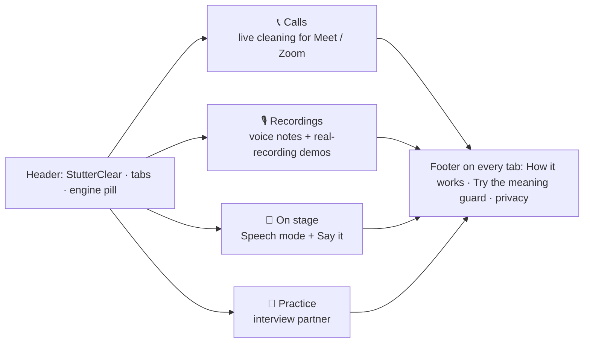
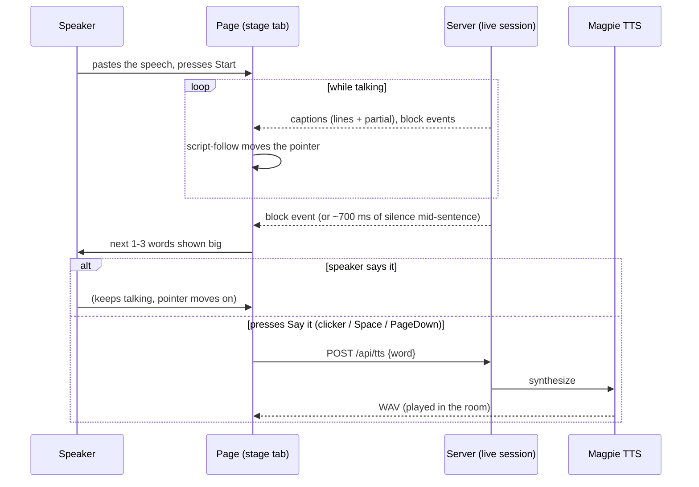
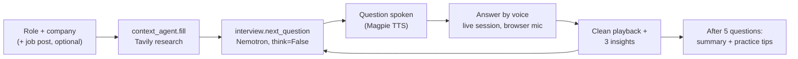
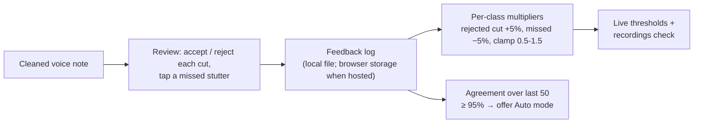
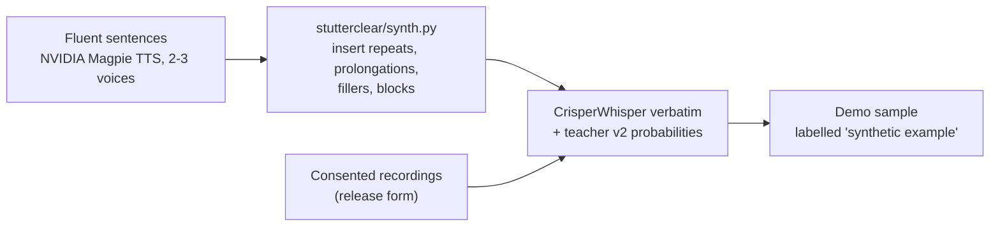
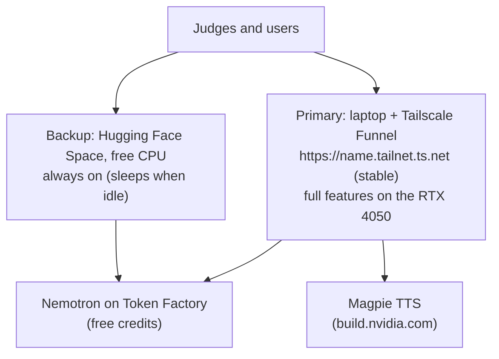
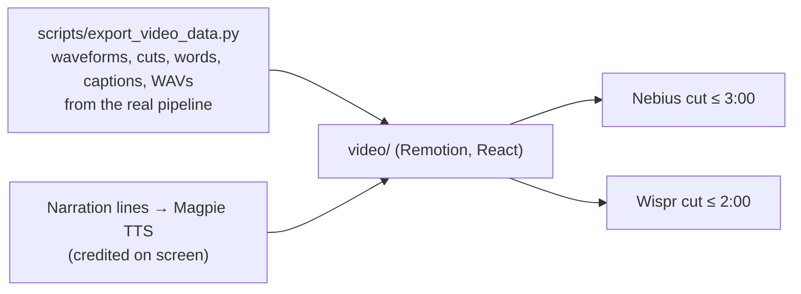
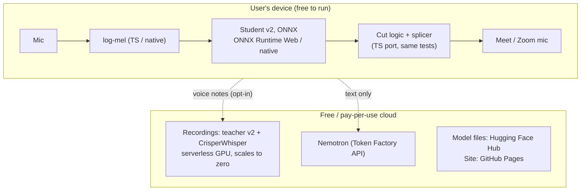
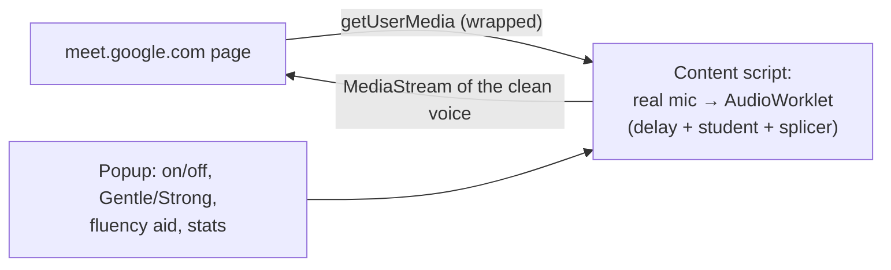

# StutterClear: design of everything left

18 Oct 2026. Part A is the hackathon (deadline **30 Oct, 10:30 pm IST**; feature freeze **27 Oct**).
Part B is the product after it. Everything is designed to cost **nothing** until we choose otherwise.
The implementation guide (`StutterClear_Implementation_Guide.pdf`) has the older work packages; this
document supersedes it where they differ.

## Decisions already made

| Decision | Why |
|---|---|
| **Teacher v1 runs live, teacher v2 runs recordings** | Measured on 7 held-out speakers: v1 wins live (Gentle 23.8 vs 18.8, Strong 48.2 vs 47.9 by removed − 3 × lost); v2 wins recordings (Natural 57.2% vs 50.1%, Thorough 90.9% vs 80.7%, fewer normal words flagged). |
| **Free hosting first** | Laptop + Tailscale Funnel (full power, stable link) and a free Hugging Face Space (always-on backup). |
| **No paid stores** | Edge Add-ons and Firefox Add-ons are free; Chrome via GitHub "load unpacked". |
| **The video is animated** | Remotion (React → MP4), driven by real pipeline output; narration by NVIDIA Magpie TTS, credited. |
| **Nobody's voice is used without consent** | Real voices only with consent; synthetic voices always labelled; "Say it" only ever on the user's click. |

## Decisions still needed (from you)

1. **Public demo clips**: replace UCLASS clips with synthetic and consented ones on public links (A7). Recommended: yes.
2. **Before/after voice in the video**: a consenting person who stutters, or the synthetic clip (labelled).
3. **Accounts**: NVIDIA API key (build.nvidia.com, free) for Magpie TTS; Tailscale (free) for the stable link; Hugging Face (free) for the backup Space.

## Status and hand-off (18 Oct)

The backend of Part A is built and tested; the pages are open for teammates. Every endpoint is in
the README's HTTP API table. The frontend is `stutterclear/app/web` (Vite + React; `npm run build`
refreshes `static/`); API calls go through `src/lib/api.ts`; features show only when `GET /api/info`
says they are available.

| Item | Done (backend) | Left (open for a teammate) |
|---|---|---|
| A1 Tabs | nothing needed | Split `App.tsx` into `tabs/*.tsx` + `useHashTab()` |
| A2 On stage + Say it | `POST /api/tts` (Magpie over gRPC, capped when hosted), `info.tts`, `scripts/check_tts.py` | `tabs/stage.tsx`, `lib/script-follow.ts`, block trigger, Say it button (fallback: `speechSynthesis`); phase 2 for calls (`Splicer.insert`, `LiveSession.say`) |
| A3 Practice | `POST /api/interview/start`, `/next`, `/summary`, `info.interview` | `tabs/practice.tsx`: question card (spoken with `/api/tts`), Answer = a browser-mic session, captions as the answer, summary at the end |
| A4 Fluency aid | nothing needed | DelayNode branch in `lib/browser-mic.ts`, switch + slider in Setup |
| A5 Feedback loop | `/api/feedback` (log, summary, forget), multipliers applied live and to voice notes, `info.feedback` | Review UI on the voice-note player (keep / undo each cut, tap a missed stutter); when `info.feedback == "browser"`: keep entries in localStorage, send `adjust` in the `/ws/mic` settings, summary via `POST /api/feedback/summary`; offer auto mode when `auto_ready` |
| A6 Timestamps | `GET /api/demo/{id}/cuts.csv` / `.srt` | Button next to Download clean |
| A7 Safe demo clips | `source` per clip, `data/demo_clips`, UCLASS off on public servers (`STUTTERCLEAR_UCLASS_DEMOS`) | `scripts/make_synthetic_demo.py` (needs `NVIDIA_API_KEY`): Magpie sentences, inserted stutters, `.crisper.json` + `.teacher.npy`, entries with `source: "synthetic"` |
| A8 Free deployment | **Done:** `scripts/serve_public.ps1` (Tailscale Funnel), `--strict-port`, `STUTTERCLEAR_NOTES=0`, `docs/DEPLOY.md` | Owner: install Tailscale and test the link. Optional: Hugging Face Space backup (CPU torch, `STUTTERCLEAR_NOTES=0`) |
| A9 Video | n/a | Everything (Remotion) |

Student v2 (5.2M parameters) was benchmarked and is not shipped: Strong 40.8% removed / 7.85% words
lost (score 17.3, rule-based 5.9), Gentle 33.4% / 12.24% (score −3.3). Next for it: calibrate its
thresholds on the 49 validation recordings, as was done for teacher v2.

How to contribute: run `python -m pytest -q` before committing; small commits with Conventional
Commit prefixes (`feat:`, `fix:`, `docs:`, `test:`, `chore:`, `refactor:`); never commit keys,
checkpoints or UCLASS / SEP-28k audio.

---

# Part A: the hackathon

## A1. The site in tabs

The page becomes four tabs by situation. Only working tabs are shown; the rest appear when built.



| Tab | Contents (existing components unless marked new) |
|---|---|
| **Calls** | Orb + Start/Stop, Off/Gentle/Strong, Setup card (mic, output, detector, save, **fluency aid** new), Fluency Mirror, live captions, stats, Context card + Word rescue, listen-back + download |
| **Recordings** | Voice-note card (record/upload), demo picker + player (Original/Clean, Natural/Thorough/Live, guard line, download, **timestamps** new), mirror replay, insights |
| **On stage** (new) | Speech mode (A2) |
| **Practice** (new) | Interview partner (A3) |

- **Routing**: `#calls`, `#recordings`, `#stage`, `#practice` so the video and Devpost can link straight to one.
  Default: hosted → `#recordings` (judges get the wow without a mic); local → `#calls`.
- **One live session for all tabs**: the session state stays in `App.tsx`; Calls and On stage are two
  views of it, so switching tabs never stops a call.
- **Feature flags** from `GET /api/info` (captions, nemotron, notes, hosted, tts) decide which tabs and
  controls show.
- **Phones**: the tabs become a sticky segmented bar under the header.
- **Where**: `App.tsx` splits into `tabs/calls.tsx`, `tabs/recordings.tsx`, `tabs/stage.tsx`,
  `tabs/practice.tsx`; a small `useHashTab()` hook. Effort: 0.5 day. No backend change.

```
┌──────────────────────────────────────────────────────────────┐
│ StutterClear   [📞 Calls] [🎙 Recordings] [🎤 On stage]   ● ready │
├──────────────────────────────────────────────────────────────┤
│  (tab content)                                               │
├──────────────────────────────────────────────────────────────┤
│  How it works · Try the meaning guard · 🔒 privacy            │
└──────────────────────────────────────────────────────────────┘
```

## A2. On stage: Speech mode + Say it

For a talk in a room, where cleaning the audio is impossible (the audience hears the real voice), the
app supports the speaker instead.



**Script-follow** (`lib/script-follow.ts`, frontend only):
1. Normalise the script into words (lower case, no punctuation, keep sentence ends).
2. On each caption update, take the last 6 spoken words (lines + partial).
3. In a window from 5 words behind to 30 ahead of the pointer, find the alignment with the most
   matching words in order; words match if equal, if one is a prefix of the other (partial words), or
   if their edit similarity is ≥ 0.75.
4. Move the pointer to just after the last matched word; never jump more than 30 words.

**Block trigger**: a `block` event from the server (`data.current.lastBlockAt` in `hooks/use-live.ts`),
or no new caption word for ~700 ms while the pointer is mid-sentence, or the speaker presses "stuck".
Without a script, fall back to Nemotron word rescue suggestions.

**Say it** with NVIDIA Magpie TTS:
- New `stutterclear/tts.py`: `available()` (NVIDIA_API_KEY set), `synthesize(text, voice)` posts to the
  hosted Magpie endpoint (`/v1/audio/synthesize`, fields text, language en-US, voice, LINEAR_PCM,
  16 kHz) and returns samples; small LRU cache by (text, voice).
- `POST /api/tts {text, voice}` → `audio/wav`; capped like the Nemotron calls on public servers;
  503 with a clear message without a key. Fallback: the browser's `speechSynthesis`.
- Phase 2, for calls: `Splicer.insert(samples)` plays a clip at the output position; the delay this
  adds is shed by the existing catch-up in natural pauses. `LiveSession.say(text)` wires it.
- Own voice (later, opt-in): Magpie TTS Zero-shot from a 5-10 s sample recorded in the app, stored
  only on the device, always labelled as a synthetic voice.

**Rules**: nothing is spoken without the press; the UI says so. Space is the Start/Stop shortcut on
other tabs, so on this tab Start/Stop moves to Ctrl+Space.

**Done when**: reading a 1-minute script, the pointer stays within 2 words; a mid-sentence pause
shows the next word within 1 s; Say it plays it. Effort: 2 days (phase 1), +1 day (phase 2).

## A3. Practice: interview partner



- `stutterclear/interview.py`: system prompt (friendly, realistic, one question at a time, follows up
  on the last answer, never comments on the stutter); keeps the last 6 question/answer pairs.
- `POST /api/interview/start {role, company}` → `{card, question}`;
  `POST /api/interview/next {history}` → `{question}`; both behind `nemotron_budget()`.
- `tabs/practice.tsx`: question card, "Answer" starts and stops a browser-mic session, then Playback
  + InsightsPanel (transcript from captions, counts from the session summary).
- Text only to Nemotron; audio stays on the server, in memory.
- Done when: a 5-question interview runs end to end with a real key. Effort: 1.5-2 days.

## A4. Fluency aid in your ear (Calls tab)

Delayed auditory feedback: the speaker hears their own voice 50-200 ms late in headphones, while the
listener still gets the cleaned voice. Browser mode: `lib/browser-mic.ts` adds a second branch
(mic source → DelayNode → GainNode → speakers); device mode later: a second output stream in
`live.py`. Setup card: switch + delay slider, headphones warning, wording "many people find it helps"
(no treatment claims). Effort: 0.5-1 day.

## A5. Human feedback loop



- Data: `{note_id, cut: {start, end, kind, words}, verdict}` and `{note_id, missed_at_s}`.
- Storage: `runs/feedback/feedback.jsonl` on a personal machine; **never on a public server**
  (there it stays in the browser).
- Applied in `live.teacher_cut_config` and in `word_cuts` (per-class confirm thresholds).
- Effort: 1.5 days. Unit tests for the update rule and the clamp.

## A6. Timestamps download

`GET /api/demo/{id}/cuts.csv` (start_s, end_s, kind, words) and `cuts.srt`, from the render timeline;
a button next to Download clean. Effort: 0.5 day.

## A7. Demo clips that are safe to publish

UCLASS is licensed for research and teaching; a public, always-on link should not stream it.



- New `scripts/make_synthetic_demo.py`; `demo_samples.json` entries gain `source: synthetic | consented
  | uclass`.
- `STUTTERCLEAR_UCLASS_DEMOS=1` enables UCLASS clips (local and private judging only); public
  servers show synthetic and consented clips.
- Effort: 1 day.

## A8. Free deployment



**Primary (laptop, free)**: `STUTTERCLEAR_HOSTED=1 python scripts/run_app.py --port 8766`, then
`tailscale funnel 8766`. Same URL every time. Keep the laptop plugged in with sleep off during
judging. A small `scripts/serve_public.ps1` starts both.

**Backup (Hugging Face Space, free CPU: 2 vCPUs, 16 GB RAM)**:
- Docker Space with CPU-only PyTorch; `STUTTERCLEAR_HOSTED=1`, new `STUTTERCLEAR_NOTES=0`
  (voice notes need a GPU to be quick).
- Live: the best CPU detector (student v2 if it beats rule-based; otherwise rule-based).
- Demos: precomputed timelines for the synthetic/consented clips (no teacher needed at runtime).
- Captions: FastConformer on CPU. Nemotron and Magpie: keys as Space secrets.
- No checkpoints uploaded (not needed, and their training data is research-only).

**Optional**: the Nebius AI Cloud VM (`docs/DEPLOY.md`) if credits cover it; it is a judging bonus,
not a requirement (Token Factory already meets the "runs on Nebius" rule).

## A9. The animated video (Remotion)



| # | Time | Scene | Animation |
|---|---|---|---|
| 1 | 0:00 | Hook | "70 million people stutter"; a waveform with glowing red repeats |
| 2 | 0:15 | Problem | A call window; the listener waits through the repeats |
| 3 | 0:30 | Before/after | Real waveform; red blocks slide out, joins close; before then after audio |
| 4 | 1:00 | How it works | mic → delay → detector → splicer → clean voice; a playhead shows the delay |
| 5 | 1:20 | Meaning guard | "I I I think that that plan is very very good": I's fly out, "that that" and "very very" get a green kept badge with Nemotron's reason |
| 6 | 1:45 | Live calls | Meet-style window, captions writing themselves |
| 7 | 2:05 | On stage / word rescue | A blinking cursor in silence; the next word appears; Say it |
| 8 | 2:20 | Under the hood | Nemotron on Token Factory, FastConformer, Magpie, WavLM (text labels, not logos) |
| 9 | 2:35 | Numbers | Counters: 65% live, 91% recordings, 0 words sliced, F1 0.618 |
| 10 | 2:45 | End card | "Your real voice, on your terms", link, repo, team |

Style: the app's dark glass, teal/rose, Geist font; burned-in subtitles; 1080p30.
Effort: 1.5-2 days. Record nothing by hand except the before/after voice (if a real person).

## A10. Schedule

| Dates | Work |
|---|---|
| 18-19 Oct | Nebius key + check; student v2 benchmark; tabs (A1) |
| 20-21 Oct | On stage (A2) + `/api/tts`; synthetic demo clips (A7) |
| 22-23 Oct | Practice (A3); fluency aid (A4) |
| 24-25 Oct | Feedback loop (A5), timestamps (A6); Tailscale + Space (A8) |
| 26 Oct | Full test on both public links; users try it |
| 27 Oct | **Feature freeze**; video data export, scenes (A9) |
| 28 Oct | Render the video; README/Devpost numbers |
| 29-30 Oct | Devpost (Nebius), then Wispr; submit Nebius by 10:30 pm IST |

---

# Part B: after the hackathon

## B1. Architecture for real users

Live cleaning must run **on the user's device**: a 0.5 s delay budget leaves no room for a network
round trip, a GPU per caller is expensive, and voices on calls are private.



## B2. The on-device model

- **Student v2** (5.2M parameters): 80-band log-mel (25 ms Hann window, 10 ms hop, 512-point FFT,
  60-7600 Hz) → causal convs (to 20 ms frames) → 3-layer GRU → one head per lookahead
  (0-800 ms).
- **Export** a streaming step graph to ONNX: input = new log-mel frames + conv context + GRU state,
  output = probabilities + new state. Quantise to int8 (a few MB).
- **Log-mel in TypeScript/native**, matching `stutterclear/student.py: LogMel` exactly; golden-file
  tests against Python outputs (tolerance 1e-4).
- **Cut logic and splicer ported to TypeScript**, with the Python tests (`tests/test_splicer.py`,
  `test_student_runtime.py`) re-expressed against shared golden files.
- Users with an NVIDIA GPU can opt into the teacher through the desktop app.

## B3. Browser extension (free: Edge Add-ons, Firefox Add-ons, GitHub "load unpacked")



- Wrap `navigator.mediaDevices.getUserMedia` on Meet (later Zoom web, Teams web) and return a
  MediaStream from an AudioWorklet running the on-device pipeline.
- Manifest V3; permissions limited to the call sites; no audio leaves the browser.
- Same code for Edge, Chrome (unpacked) and Firefox (small changes).

## B4. Desktop app (free via GitHub Releases)

Tauri UI + the on-device engine (native ONNX Runtime), for Zoom/Teams desktop and any app. Needs a
virtual microphone: VB-CABLE at first (free download); a bundled driver needs code signing, which
costs money, so later. Windows will warn about an unsigned app until then.

## B5. Phone (later)

Voice notes first: share a WhatsApp/Telegram voice note to StutterClear, get it back cleaned
(on-device student, or the cloud recording engine). Live phone calls are not open to apps on iOS.

## B6. Data and licences for a real product

The current models learned from research-only data (SEP-28k non-commercial, UCLASS, CrisperWhisper).
A public product needs models retrained on commercially licensed or **consented** recordings:
- opt-in "donate my recording" in the feedback loop (A5), with a clear consent form and deletion;
- the same Kaggle training pipeline, new data sources.

## B7. Research next

- **Adaptive delay with reinforcement learning**: learn when to wait and when to cut, trained in the
  `eval_live.py` simulator on training speakers, tested on held-out ones.
- **Better blocks**: silence where speech is expected (script or language model), tension cues.
- **Meaning guard vs humans**: annotated intended-repetition test set; false-delete rate as the
  headline metric.

## B8. Rules that do not change

- The listener only ever hears the speaker's real voice, unless the speaker presses Say it.
- No cure or treatment claims.
- Never tune on the 7 test speakers.
- Keys and recordings never go into git or chat; text, never audio, goes to language models.
